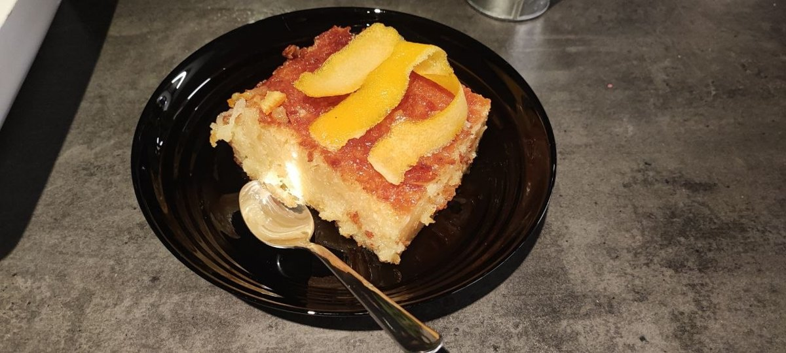
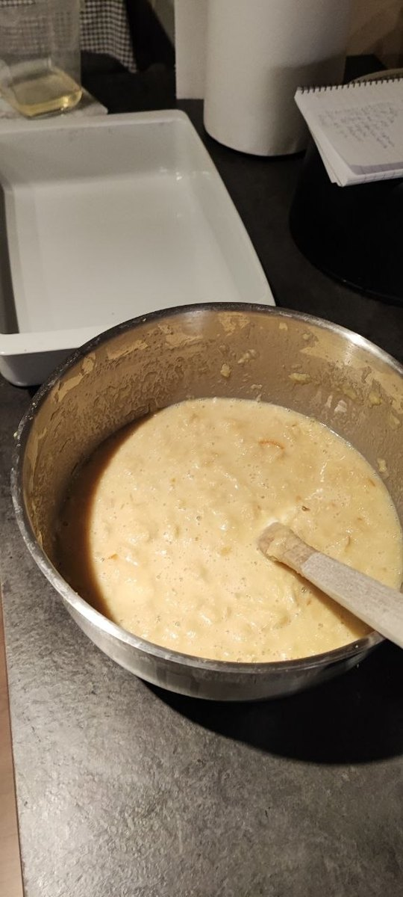
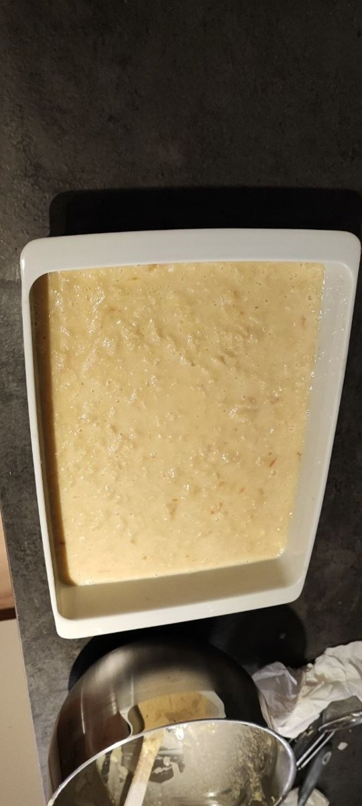
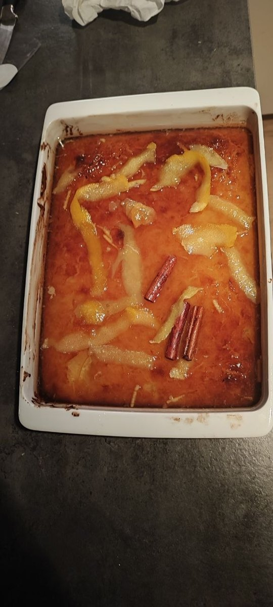
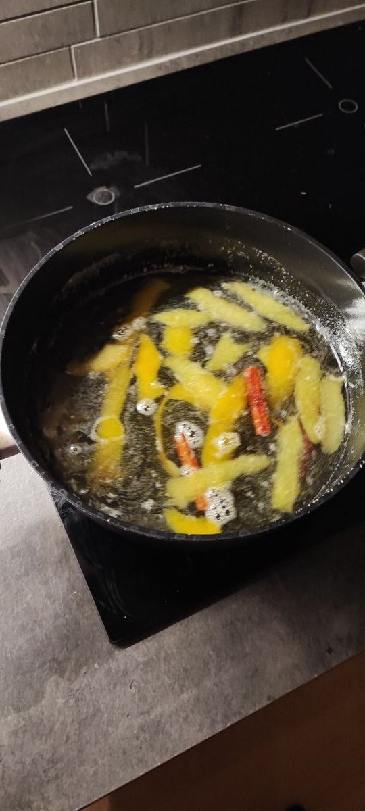

No lab work this week. I made a cake instead, out of pastry that was past its best.

That is not an apology for the pastry. It is the recipe.

## The dish is built from waste

Portokalopita is a Greek orange cake, and the thing holding it together is phyllo — the paper-thin pastry used for baklava and spanakopita. Not fresh sheets. Dried ones.

You take the phyllo, cut it into strips, spread it on a tray and **dry it out on purpose** — fifteen minutes in a low oven, or just left on the table. Then you crumble it into pieces and fold those into the batter until they vanish into it.

Traditionally this is what you did with the leftovers. Phyllo dries out fast once the packet is open; the sheets go brittle and tear and are useless for anything that needs them whole. So somebody worked out that brittle is exactly what this cake wants.

Here is the part that matters: **fresh phyllo makes it worse.** Soft sheets go gluey and clump. The dish needs dry pastry because dry pastry drinks the syrup. The thing that made it rubbish for its original purpose is the thing that makes it right for this one.

## My rack is made of leftovers

Every significant piece of equipment I own was thrown out by somebody else.

Two Dell R620s with Xeons from 2013. An HPE DL360 Gen9. A Catalyst 3850 that was somebody's core switch until it was not. A 3560CG. An 891F edge router. All of it decommissioned enterprise kit, bought second-hand, well into the part of its life where a company has already written it off.

The obvious reading is that this is how you build a lab cheaply, and that is true. A new switch with those capabilities costs more than my car.

But cheap is not actually the reason, any more than thrift is the reason for the phyllo.

I wanted to learn iDRAC and iLO — the small management computers built into enterprise servers that let you control a machine that is powered off. I wanted RAID controllers with their own opinions, redundant power supplies, firmware that does not always cooperate, and a boot sequence long enough to make you doubt yourself. I wanted out-of-band management to be a real thing I cable, not a diagram.

A modern mini PC does none of that. It is a better machine by almost every measure — quieter, faster per watt, less hassle. And it would have taught me nothing I am actually trying to learn.

The gear is obsolete for the job it was bought to do. That is precisely what makes it right for the job I bought it for.

## The honest part

It is not a free lunch, and I would be lying by omission if I left it there.

2013-era Xeons draw serious power, and Swedish electricity has opinions in winter. Firmware updates for most of this hardware stopped years ago, which means security fixes stopped too — fine for an isolated lab, not fine anywhere else. Parts come from eBay and the internal batteries in the RAID controllers are all living on borrowed time.

And some of what it teaches is genuinely historical. I wrote about this in September: hardware RAID with battery-backed cache is essential knowledge and increasingly a description of mid-sized infrastructure rather than large. At scale, redundancy moved into software.

So the honest version is: old equipment is the right choice for learning the operational layer, a poor choice for learning what the largest environments do now, and a bad choice for anything that has to be secure and cheap to run.

The phyllo has the same shape. Stale is correct here and wrong almost everywhere else.

## The recipe

Adapted from [Cuzina Gias](https://cuzinagias.gr/recipe-items/πορτοκαλόπιτα/). I left out the liqueur.

**Syrup** — 800 g sugar, 800 ml water, 300 ml fresh orange juice, the peel of an orange and a lemon, the juice of a lemon, a cinnamon stick, 2 tbsp honey.

Everything in a pot, boil for three minutes, off the heat, stir in the honey. Then leave it alone until it is completely cold. This matters later.

**The phyllo** — 500 g, roughly ten to twelve sheets. Thaw, cut into strips with scissors, separate them, spread on a tray. Fifteen minutes at 150 °C fan, or leave it out on the table. When it is properly dry, crumble it small.

**Batter** — 4 medium eggs, 150 g sugar, 200 g yoghurt, 200 ml orange juice, 200 g orange marmalade, the zest of 4 oranges and their pulp with the seeds out, 150 g fine semolina, 2 tbsp baking powder, 200 ml sunflower oil, vanilla.

Beat the eggs and sugar pale. Everything else in. Mix smooth.

Then fold the crumbled phyllo in a handful at a time, until it has disappeared into the batter.

**Bake** — greased pan, around 30 × 40 cm. Not too wide; you want some height. 170 °C for about 40 minutes, until golden.

**Syrup** — out of the oven, poke holes all over it with a skewer. Then **cold syrup onto the hot cake.**

Same rule as the galaktoboureko I wrote about last month. Greek desserts have firm views about temperature differences, and all of them boil down to: one of the two things must be cold, and it is never the one coming out of the oven.

I topped it with orange peel candied in a little of the syrup, and the cinnamon sticks from the pot, because they had done the work and deserved to be seen.

**Rest an hour** so the syrup gets all the way in. Then cut.

That is a cake built almost entirely out of something that had stopped being useful.

I find that a reasonable thing to have in the oven while sitting in a room full of equipment somebody else decided was finished.

---

*I'm Ioannis — an IT operations, systems, and networking engineer based near Stockholm. The Itchef Hybrid Project (IHPC) is a real hybrid infrastructure lab, built and documented in public. Repo: [github.com/TheITchef/IHPC](https://github.com/TheITchef/IHPC) · [LinkedIn](https://www.linkedin.com/in/ioannis-mintzivyris-a1b77873/)*
