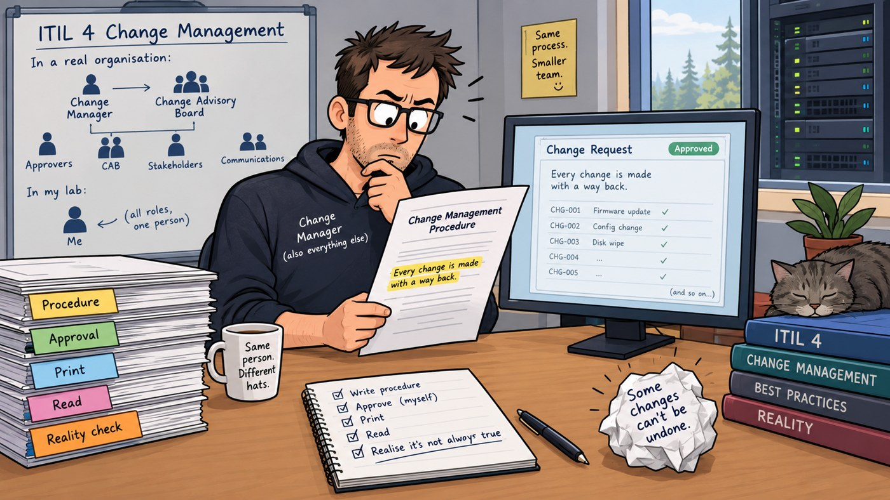

I printed the procedure, read it on paper, and caught it lying to me.

Not badly. Not on purpose. It said every change is made with a way back.

That is not true. And I had approved it two hours earlier.

## The gap

My old change procedure covered changes to documents. Which file, who reviewed it, what version. Tidy.

It covered nothing at all about the lab. Hardware, cabling, power, firmware, device settings — none of it.

The question that found the hole was embarrassingly small: *does moving a cable count as a change?*

Yes. Of course it does. I had spent two weeks moving cables and recorded exactly none of them.

So the rule is written down now: **when in doubt, it is a change.** Switching a device on or off is not. Looking at one is not. Everything else is.

## First, the foundation

The Documentation Standard had to be fixed first. Every other document leans on it, and it was still a draft — the kind of thing you find when you audit your own paperwork, as I did last week.

It is approved now. The useful part was throwing away my invented labels and using the ones the industry already has: controlled document, ADR (a short note recording why a decision was made), record, log, register.

Inventing your own vocabulary is a way of making your work unreadable to everyone except you.

Two rules in it I would keep anywhere.

**Say where the record lives.** Not "access is logged" but "logged in the Privileged Access Log." A sentence that says logging happens without saying where is a sentence nobody can check.

**Public by default.** Identifiers show the last four characters only. Decided once, so I never have to decide again at midnight.

## The procedure

Then the actual thing: ITIL 4 change enablement — the standard industry practice for handling IT changes — shrunk to fit one person in a flat.

A note on the name, since it catches people out. ITIL 4 first called this *change control*, then renamed it *change enablement*. Both are still in use. The detail lives in the *Create, Deliver and Support* volume; Foundation gives it a page and moves on.

I read it next to Google's *Site Reliability Engineering*, free online, which argues the opposite way round — small frequent changes beat large rare ones. ITIL tells you how to control a change. SRE tells you to make it small enough that controlling it is cheap. A one-person lab needs the second argument more than the first.

Three types of change. **Standard**: done before, proven, pre-approved. **Normal**: the plan gets read before anyone touches anything. **Emergency**: something is genuinely on fire.

Priority comes from impact and urgency, judged separately, which gives P1 to P4. Only P1 counts as an emergency. My favourite line in the whole document: **inconvenience is not an emergency.** Almost everything that feels urgent at 23:00 is a P3 in a costume.

If something is actively doing harm, you are allowed to stop it first — unplug the cable, shut the port. You need a change record to light a fire, not to put one out.

Where a company would have a second person approve the work, I have a written plan, read before anything is touched. It is not as good. It is what I have.

Every change record has two halves. The plan — why, what could go wrong, the state before, the steps, the backout plan, how success gets checked — approved first. The outcome and the review added afterwards, dated. Anything discovered after the fact gets written down the day it is found, never backdated to look tidier.

And the first entry in the standard-change catalogue is marked *candidate*, not standard. Nothing becomes a standard change until it has worked once as a normal one. You do not get to pre-approve something you have never actually done.

## The lie

I printed version 1.0 and sat down with it.

*Every change is made with a way back.*

Some changes have no way back. Firmware that will not downgrade. A wiped disk. Promising rollback in every case is promising something you cannot deliver — and it fails precisely when you most need it to be true.

Version 1.1 went in the same day.

The backout plan now has to name the **point of no return** — the step after which you cannot get the old state back — and say how the device is recovered once you are past it.

And when a check fails, work stops. Three options, pick one: **back out**, **hold** (leave it somewhere safe, change stays open), or **continue** (only if the thing that went wrong has nothing to do with what the failed check was protecting).

"Fix forward" is not a fourth option. Improvising on the spot is a new change with its own record. What ruins an evening is never the failed step. It is the four undocumented fixes that follow it.

## What paper did

The screen had shown me that sentence a dozen times. Paper caught it on the first read.

So the review copy gets printed **before** approval now, not after, with "DRAFT — for review" in the footer. The approved copy goes in the folder marked "Uncontrolled when printed," so nobody ever trusts a sheet of paper over the repository.

And approval is a comment on the pull request naming the exact version reviewed. "Looks fine" in a chat window is not evidence of anything.

## The slips

Twice in a row I clicked through GitHub's merge dialog without reading it. The main branch now permanently carries a commit called "Feature/operational change procedure 1 1". Rewriting shared history to fix a title is a much worse crime than the title, so it stays. New habit: read the box out loud first.

And a procedure about controlled change was revised the day it was approved. That is the process working, not failing. Better to find out on day one than on the day it matters.

## What this is not

No change has been run under this procedure yet. It is approved, not proven. The first real change record will be the test of it.

The network phase is still closed with open exceptions. This week was paperwork, not cables.

And my second approver is a printed page and a careful read. I am aware that is not the same as a colleague.

---

One to sit with, because I do not have a clean answer either.

You upgrade a core switch's firmware. It reloads. Two VLANs pass no traffic. The vendor does not support downgrade.

What do you do, in order — and what does your change record say?

---

*I'm Ioannis — an IT operations, systems, and networking engineer based near Stockholm. The Itchef Hybrid Project (IHPC) is a real hybrid infrastructure lab, built and documented in public. Repo: [github.com/TheITchef/IHPC](https://github.com/TheITchef/IHPC) · [LinkedIn](https://www.linkedin.com/in/ioannis-mintzivyris-a1b77873/)*
