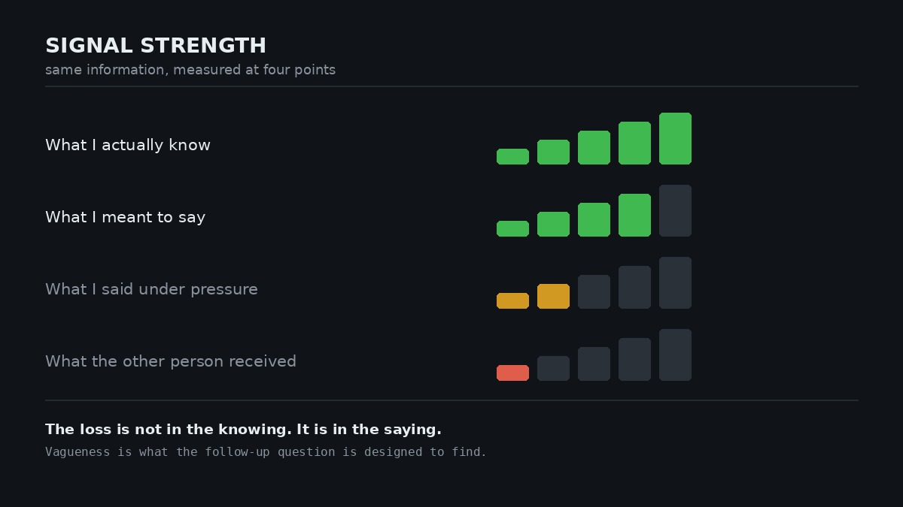

I opened the rack this week to check that nothing had changed since the last time I wrote anything down.

Nothing had. Every cable where the record says it is. Every connection as recorded. No surprises.

That is the first time in months that the documentation and the physical reality have agreed with each other without an argument. I have spent since September writing posts about the opposite: a survey listing a UPS I do not own, a port map that needed three revisions in one session because the cables kept disagreeing with it, forty cables I could not prove went back to the right ports, an access rule that had been facing the wrong way since the day I switched the equipment on.

So a quiet check that produces nothing is a result. The baseline holds, which means testing can resume next week from a known state rather than from an assumption.

That took an hour. The rest of the week was a different kind of verification, and considerably less comfortable.

## The part I have been avoiding

I started reading *Signal Strength* by Andrew LaCivita, which is about communication — what you say, how you say it, and what your body is doing while you say it.

I did not pick it up because I think communication is a soft add-on to technical work. I picked it up because I have been losing things I should not have lost, and not all of the reasons were technical.

Last week I wrote publicly that I had been caught in interviews blurring the line between operating infrastructure and designing it. I framed that as a problem of self-assessment — knowing your actual level.

Reading this week, I think that was only half right.

Knowing your level and being able to **state** it accurately, under pressure, to someone evaluating you, are two different skills. I have had the first one for a while. The second is where I keep losing ground.

When a technical question lands near the edge of what I know, the honest answer is a specific sentence: here is what I have done, here is what I have not, here is how I would find out. That sentence exists. I know what it is. Under pressure I have reached instead for something vaguer and more generous, and vagueness is the thing the follow-up question is designed to find.

That is not a knowledge gap. It is a communication failure wearing a technical costume.

## The other half

The book has also made me re-read my own history with teams, which is less pleasant than re-reading my own documentation.

Ten years of third-line support and systems administration means ten years of explaining things across boundaries — to users who do not have the vocabulary, to developers who have a different one, to managers who want the consequence rather than the cause. I have generally thought of myself as good at that.

Going back over specific moments with a framework in hand, I can see several where I was clear and several where I thought I was clear. The distance between those two is where most of my worst weeks came from.

I am not going to pretend a book fixes that. But naming a failure mode is the first thing that makes it visible, and I have spent three months arguing on this blog that a defect you can name is cheaper than a defect you cannot. It would be inconsistent to apply that only to access lists.

There is a parallel thread running alongside this, in which I am working through a structured questionnaire about role fit, values and where I actually want to go — rather than applying to things because they are open. That is not finished and I am not going to write about it until it is.

## Seeing the size of a thing

The third piece of the week: I watched Tech With Nana's introduction to DevSecOps, ahead of the course starting on Tuesday.

It is a practical walkthrough — security built into each stage of the software delivery lifecycle, with the actual tooling at each point — and my honest first reaction was that the field is enormous.

Not difficult, exactly. Large. There is a tool for every stage and several competing tools per stage, and the stages themselves assume a software development process I have worked alongside rather than inside.

That reaction is worth recording, because "this is huge" is the correct response to seeing an unfamiliar field properly for the first time, and it is also a thing people hide. Six months from now I will either have a map of it or I will have learned a few tools and be pretending to have a map. The difference between those two will come down to whether I can keep describing my position accurately while I am in the middle of it.

Which is the same problem as the interview sentence. It keeps being the same problem.

## Next

Hardware and infrastructure testing resumes next week, against a baseline I have now verified rather than assumed. The course starts Tuesday.

A week in which I built nothing and checked three things: that my rack still matches its records, that my technical weaknesses are not purely technical, and that the subject I have just enrolled in is bigger than I thought.

Two of those were uncomfortable. All three were useful.

---

*I'm Ioannis — an IT operations, systems, and networking engineer based near Stockholm. The Itchef Hybrid Project (IHPC) is a real hybrid infrastructure lab, built and documented in public. Repo: [github.com/TheITchef/IHPC](https://github.com/TheITchef/IHPC) · [LinkedIn](https://www.linkedin.com/in/ioannis-mintzivyris-a1b77873/)*
