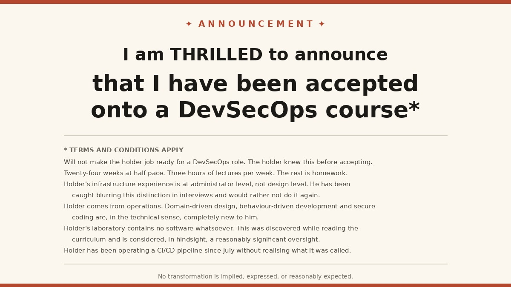

I start a [DevSecOps course](https://www.nbi-handelsakademin.se/utbildning/devsecops-med-sakerhetsinriktning/) on 24 November. Part-time, distance, 24 weeks, 60 YH credits, at NBI/Handelsakademin.

It will not make me job ready for a DevSecOps role, and I knew that before I accepted the place.

That is not false modesty and it is not a complaint about the course. It is the result of spending this week doing the only preparation that was actually useful: working out honestly what I already have, what is genuinely new, and what twenty-four weeks can realistically change.

## What the subject actually is

DevSecOps is the practice of building security into every stage of the software development lifecycle — the whole path from someone writing a requirement, through code, testing, deployment and running the thing in production — instead of bolting a security review onto the end.

It belongs to the security field rather than the development one. The point is not to make developers into security specialists. It is to stop security being a gate that work queues up behind, and make it a property of the pipeline the work already moves through.

That reframing cost me a couple of evenings to really absorb, and it is the single most useful thing I learned this week.

## The audit

I have spent three months on this blog auditing documents against acceptance criteria. This was the same exercise pointed at myself.

**What I have a foothold in.** The first course covers virtualised infrastructure, monitoring, threat modelling, risk analysis, distributed authentication and encryption.

I need to be careful about how I describe my relationship to that list, because getting it wrong has cost me in interviews before.

My background is third-line support, systems administration, cross-functional problem solving and customer-facing work. Ten years of keeping real environments running for real users. I have good hands-on infrastructure experience — hypervisors, Windows Server, Active Directory, Cisco switching — at administrator level. Operating it, troubleshooting it, fixing it when it breaks.

That is not the same as designing it. The design-level work — segmentation, trust boundaries, threat modelling — is something I have been doing deliberately in my own lab for a few months, not something I have ten years of in production. When I have blurred that line in a technical interview, the follow-up question found it immediately. It always does.

So: a foothold, not a foundation. I will recognise much of the first course and still be learning it properly for the first time.

**What is genuinely new.** Domain-driven design. Behaviour-driven development. Automated testing, regression suites, OWASP, secure code.

I come from operations, not software development. I am not ignorant of the software lifecycle — I have worked alongside it for a decade and I know the principles. But knowing the principles and having worked deeply in them are different things, and pretending otherwise would last about one interview question.

Twenty-four weeks at half pace will not close that. It will give me the shape of it, the vocabulary, and enough practical exposure to know what I do not know. That is a genuinely valuable thing to own. It is not the same as being ready to do the job.

## The pipeline I had already built

One good discovery while mapping the curriculum.

The third course covers CI/CD — the automated path from a change to a deployment — and continuous delivery culture.

This blog has run on exactly that since July. Every post is a commit. Every push triggers a build, which runs a pipeline and publishes the result. I set it up without once thinking of it as CI/CD, because at the time I was just trying to get a blog online without clicking things.

Finding out you already use something you are about to be taught is a cheering feeling. It is also a small lesson in how much of this is vocabulary gatekeeping rather than difficulty.

## The gap the curriculum exposed

Here is the part I did not expect, and it is a defect in my own project rather than in the course.

My lab is an infrastructure lab. Servers, switches, segmentation, identity, eventually monitoring and backup. All of it is about running things.

There is no software in it. Nothing to build. Nothing to test. Nothing to deploy.

A course about securing software delivery has, in my environment, nothing to deliver.

I only saw that by laying the curriculum next to the project plan. The lab was built to demonstrate infrastructure competence and it does that; the gap is invisible until you look through a lens that assumes an application exists. Which is a reasonable description of how most blind spots work.

I have not decided what to do about it yet. The sensible move is to wait and see what the course supplies — a distance course with no required reading usually ships its own environment and sample code — and decide once I know, rather than inventing a project now to fill a hole I have only just noticed.

## So why do it

Because it complements where the lab is actually going.

The next phase of my project is identity: domain services, certificate infrastructure, federation. Identity and access management is the discipline that decides who can do what, and it sits underneath everything in DevSecOps — distributed authentication, secrets, pipeline permissions, the question of what a build agent is allowed to touch.

Learning the security practice around software delivery while building the identity layer underneath it is the right order to meet those two. They explain each other.

And some of the coursework should run on my own infrastructure, which turns an exercise into something that leaves a trace.

## The honest summary

Twenty-four weeks, half pace, starting 24 November.

It will give me a vocabulary I do not have, a second discipline's view of problems I meet from the operations side, and a real sense of where my software-side gaps are.

It will not turn a support and systems engineer into a DevSecOps engineer in six months, and anyone who tells you a part-time course does that is selling something.

Knowing which of those two I signed up for is, I think, the whole point of doing the audit first.

---

*I'm Ioannis — an IT operations, systems, and networking engineer based near Stockholm. The Itchef Hybrid Project (IHPC) is a real hybrid infrastructure lab, built and documented in public. Repo: [github.com/TheITchef/IHPC](https://github.com/TheITchef/IHPC) · [LinkedIn](https://www.linkedin.com/in/ioannis-mintzivyris-a1b77873/)*
