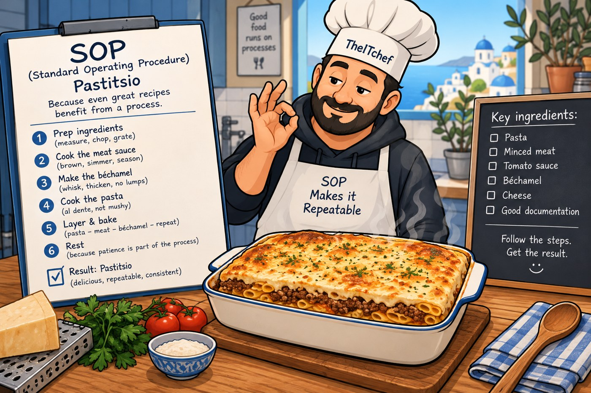
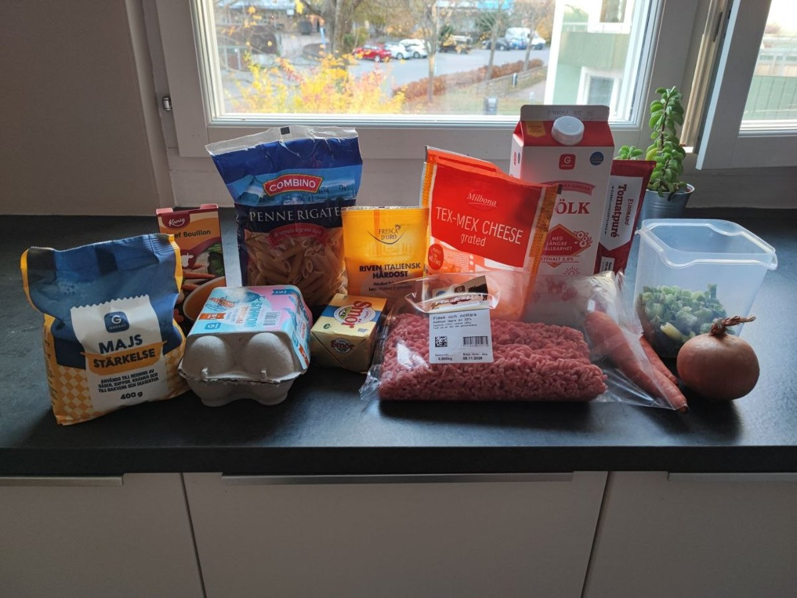
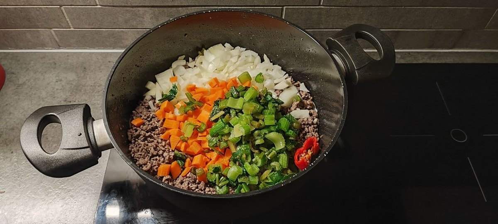
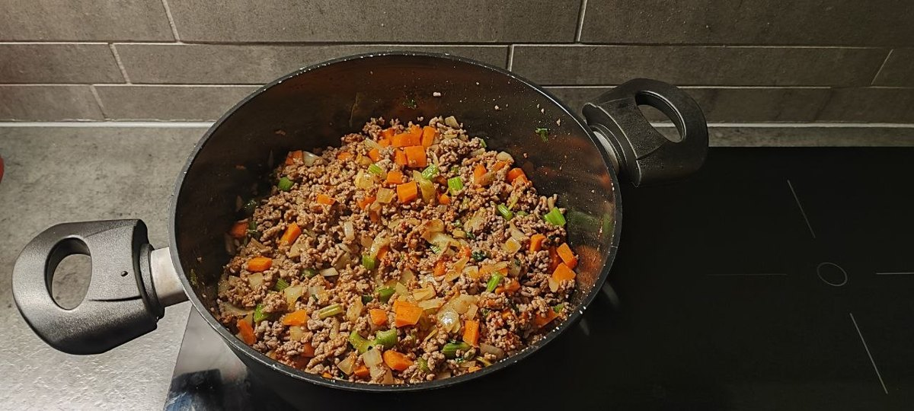
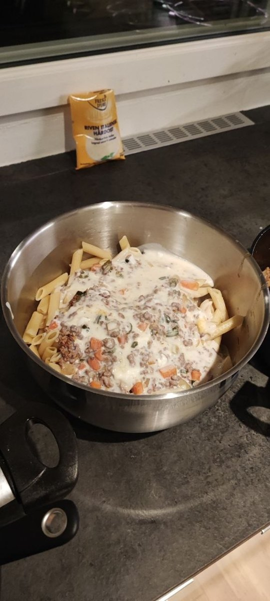
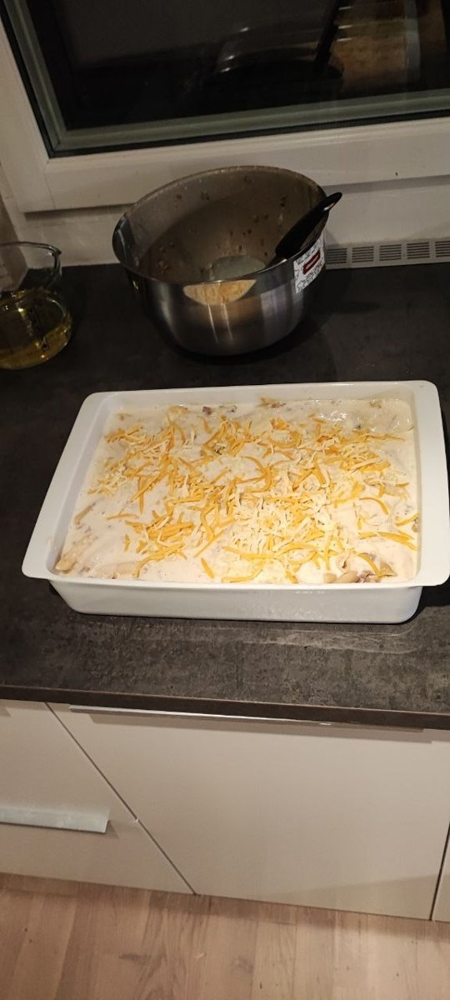
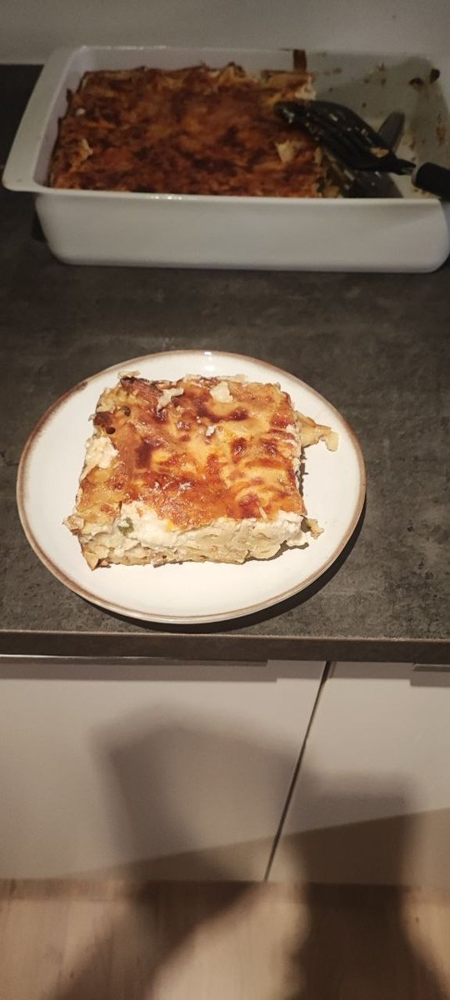

There is a moment in making pastitsio when you cannot go back.

The béchamel goes on. From that point, every layer underneath is sealed. Pasta too dry, sauce too wet, not enough salt — none of it can be fixed. It goes in the oven and you find out in forty minutes.

I spent this week revising a procedure for my lab, which includes a rule about exactly that: a plan has to name the **point of no return** — the step after which you cannot get the previous state back. Firmware that will not downgrade. A disk you have wiped.

Then I made dinner and realised I have been doing this for years without calling it anything.

## A procedure is a recipe

That is not a metaphor. It is the same document.

Both list what you need before you start. Both set out steps in an order you cannot rearrange. Both describe what it should look like when it is right. Both, if they are any good, tell you what to do when it is not.

And both are only worth anything after they have been run several times by someone paying attention.

The pastitsio I make is not the one I was taught. Three things have changed, each for a reason, and each one maps onto something I had to argue myself into at work.

## One: borrow a method that already works

The traditional meat sauce starts with onion. Mine starts with onion, carrot and celery — the Italian *soffritto* — plus garlic and a little chilli.

That is not me being clever. It is me using somebody else's proven base because it is better than the one I had. Carrot brings sweetness that tomato on its own does not, and celery brings a savoury depth that makes the sauce taste like it cooked longer than it did.

I did the same thing to my documentation standard earlier this month. I had invented my own labels for document types, which felt productive and made my work unreadable to everyone except me. I threw them away and used the ones the industry already has.

Inventing a vocabulary is rarely the contribution you think it is. Neither is inventing a base.

## Two: make it harder to do badly

The classic béchamel is a roux: melt butter, cook flour into it, add milk slowly. It is a good technique and I can do it. It also has several ways to go wrong — the roux can catch, the flour can stay raw, the milk can go in too fast and leave lumps you then spend five minutes fighting.

Mine is milk and cornflour. Slurry in cold milk, into the hot milk, whisk until it thickens. Fewer steps, fewer failure modes, and almost impossible to make lumpy.

It is slightly less rich. I have decided that trade is worth it, because a procedure that only works when you are concentrating is a procedure that will eventually be run by somebody tired.

That one applies directly to the lab. If a runbook needs you to be sharp to execute it correctly, the runbook is the problem, not the operator.

## Three: fix the defect, not the symptom

Here is the real divergence, and the one I would defend hardest.

Traditional pastitsio is strictly layered: pasta on the bottom, meat sauce over it, béchamel on top. Three clean strata, which is where the dish gets its looks.

It also has a recurring fault. The pasta at the edges and corners dries out. Not catastrophically — but there are patches, every time, and everybody who makes it knows about them.

So I stopped layering the bottom two. The cooked pasta, the meat sauce, a couple of spoonfuls of béchamel and a handful of cheese all go into a large bowl and get mixed. That becomes the lower layer. The rest of the béchamel goes over the top as usual.

The texture is softer and the dry patches are gone, because every piece of pasta now has sauce on it rather than only the ones that happened to be near some.

The point: I stopped working around a known defect and changed the method so the defect cannot occur. Dry patches were an incident I kept handling. Mixing the bowl was the fix.

## The part I only noticed this week

There is a second effect I had never thought about until I spent a week writing about irreversible steps.

Mixing in a bowl **moves the point of no return later.**

In the traditional build, the pasta goes into the dish and is immediately committed. Everything after that gets layered onto something you can no longer taste, adjust or rescue.

In mine, the pasta, sauce, béchamel and cheese meet in a bowl where everything is still reversible. I can taste it. I can add salt. I can loosen it with another spoon of béchamel if it looks tight. Nothing is final until it goes in the dish.

I did not design it that way. I did it for texture. But it is the better shape, and it is the same principle I apply to a change plan: do as much as possible while you can still back out, and make the irreversible step as late and as small as you can.

A recipe taught me that before a procedure did.

## The recipe

Base version from [My Greek Dish](https://www.mygreekdish.com/recipe/pastitsio/), which is a good traditional one. My changes are marked.

**Pasta** — 450 g. Traditionally this is the thick hollow No. 2 tubes. *I used penne rigate* ← my change, because that is what the shop near me reliably has, and a procedure you can only run when a specific ingredient is in stock is a procedure you will not run often.

**Meat sauce** — 800 g minced beef and pork, 1 onion, *2 carrots and the celery, all chopped small* ← my change, garlic, *a fresh chilli* ← my change, tomato purée, red wine, a cinnamon stick, bay leaves, a beef stock cube, olive oil, salt and pepper.

Brown the mince first, then the onion, carrot, celery and chilli in with it. Soften them properly — this takes longer than you think and is the whole point of the change. Garlic and tomato purée next. Wine in, let it cook off. Stock, cinnamon stick, bay. Simmer until most of the liquid is gone, then fish out the cinnamon and bay.

**Béchamel** — *1 litre milk thickened with cornflour instead of a butter-and-flour roux* ← my change, a knob of butter, 2 whole eggs, grated Italian hard cheese, nutmeg, salt.

Heat most of the milk with the butter. Slurry the cornflour into the cold remainder, whisk it in, keep whisking until it thickens. Off the heat, whisk in the eggs, the cheese, a good grating of nutmeg and the salt.

Whole eggs rather than yolks only, which is less classical and means nothing is left over. The nutmeg is not optional. It is the thing that makes béchamel taste like béchamel rather than thickened milk.

**Assembly** — boil the pasta two or three minutes short of the packet, since it cooks again in the oven.

*Then, my change:* the pasta, the meat sauce, a couple of ladles of béchamel and a handful of cheese all go into a large bowl and get mixed properly. Taste it now, while you still can.

Into the buttered dish, about 25 × 35 cm. The rest of the béchamel over the top, smoothed out, and grated cheese scattered over that.

180 °C, about 40 minutes, until the top is golden and blistered.

Then let it rest before cutting, or the layers slide and you get pastitsio soup.

That last instruction is the one everybody ignores, including me, about one time in three.

---

*I'm Ioannis — an IT operations, systems, and networking engineer based near Stockholm. The Itchef Hybrid Project (IHPC) is a real hybrid infrastructure lab, built and documented in public. Repo: [github.com/TheITchef/IHPC](https://github.com/TheITchef/IHPC) · [LinkedIn](https://www.linkedin.com/in/ioannis-mintzivyris-a1b77873/)*
