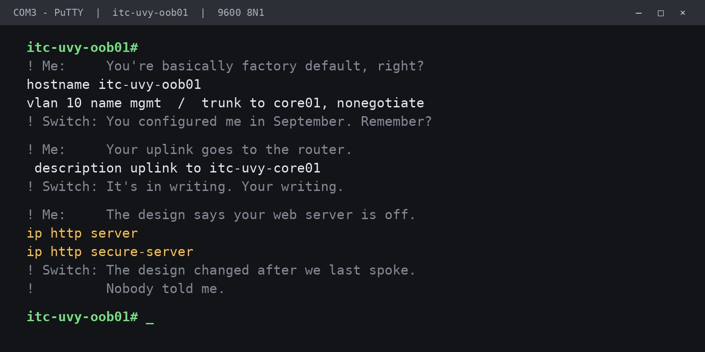

For three weeks I didn't touch my lab. The rack sat in the living room, switched off. I walked past it every day.

The problem was the paperwork. Every session started with a long checklist and a list of 33 open tasks. So I stayed away.

This week I tried something simple. One cable. The smallest switch. I just looked at it.

I thought it was almost empty. It wasn't. It still had all the settings I gave it in September.

I thought its cable went to the router. The switch said it goes to the core switch. I wrote that label myself.

My design says the switch's web server is off. On the switch, it was on. I changed the design later and never updated the switch.

I also found a file from 2018, left by a previous owner. Deleting the settings doesn't delete the old files.

The software is from 2011. A newer version exists, but I can't download it safely. The switch has no network address, so nothing can reach it. I wrote down the risk and kept the old version.

Then I wanted to fix everything. My own rules stopped me: plan first. That was lucky. My switches share VLAN information with each other, and my design says nothing about how. Fixing one switch alone could break the others.

Some notes lived on a laptop I sold. They're gone. If it's not in Git, it doesn't exist.

**Changed:** nothing.

**Tasks:** 33 down to 7.

**Learned:** my memory needs more checking than my switch.

**Next week:** the other two devices.

---

*I'm Ioannis — an IT operations, systems, and networking engineer based near Stockholm. The Itchef Hybrid Project (IHPC) is a real hybrid infrastructure lab, built and documented in public. Repo: [github.com/TheITchef/IHPC](https://github.com/TheITchef/IHPC) · [LinkedIn](https://www.linkedin.com/in/ioannis-mintzivyris-a1b77873/)*
