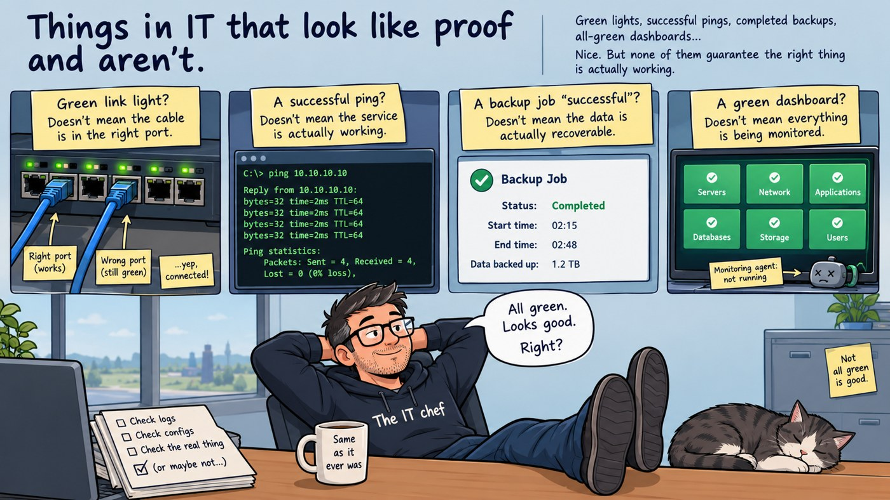

Three weeks ago I wrote a document that described a piece of equipment I have never owned.

A rack survey, dated 2 October, listing an uninterruptible power supply. There isn't one. I do not own a UPS. I have never owned a UPS. I wrote it down anyway, read it back, and approved it.

That is where this week started, and it got worse from there.

## The most reassuring lie in networking

Earlier this month I re-cabled the whole rack. Every data cable out, one at a time, re-routed down the right side away from the power, back in. Labels updated.

When I finished, every link light was green.

That felt like success. It is not nothing — a green light means there is a working electrical connection, at both ends, negotiating a speed.

It does not mean the cable went back into the right port.

I am fairly confident I got all forty-odd of them right. I did the work carefully and one cable at a time, which is the correct method. But *fairly confident* is not a verification, and a rack full of green lights would look exactly the same if I had swapped two of them.

The only real check is tracing every link against the port map. That happens at the next survey. Until then the record says **not verified**, because that is the true thing to write.

## The others

Once you notice green lights, you start noticing the rest of them.

**A successful ping.** Proves something at that address answered. Not that it is the host you think, not that the service is up, not that the return path is the one you designed. I found out the hard way last month that it can also fail for three unrelated reasons at once and still look like one problem.

**A backup job that reports success.** The job ran. Something was written. Whether it can be restored is a completely separate question, and the only way to answer it is to restore something. A backup you have never tested is a belief, not a backup.

**A dashboard that is entirely green.** Sometimes this means everything is healthy. Sometimes it means the agent stopped reporting and nothing was watching for silence. The most dangerous monitoring failure does not produce an alert — it produces calm.

**A configuration file that reads correctly.** I wrote about this one in September, when I found a rule in my own network facing the wrong direction. Right command, right place, correct intention documented beside it. Only a real packet found it.

The pattern is the same in all of them. Each one is a *signal* that is easy to collect and feels like a *result*. We accept it because it is cheap and it points the right way. The actual check is slower, more boring, and the only one that tells you anything.

## Which is what the paperwork was for

The reason all this came up: I spent the week writing change records for three things I did to the rack before I had a procedure for it.

In ITIL 4 change enablement — the standard industry practice for handling IT changes — these are **unauthorised changes**. Work that happened with no record, found afterwards. The practice is unambiguous about what you do: raise a record now, dated now. You do not backdate it to look tidier, and you do not pretend it never happened.

Three records. A disk swap at the end of September, the power cabling, the data cabling.

Only one of them can be proven. The disk swap is confirmed by that same 2 October survey, which found a SAS disk in bay 0 and no trace of the SSD that used to be there — independent evidence, recorded before I needed it, which is the only kind worth anything.

The other two say *not verified*, and in several places they say *not known*. The exact date of the cabling work. Which power strip fed which supply before I moved them. Whether every cable went home to the same port.

None of that was written down at the time, so it is gone. That is the real cost of working before you have a process. Not that the work was wrong — I think it was fine. It is that I can no longer demonstrate it was fine, and "I remember doing it carefully" is not a thing you can hand to anyone.

## The quiet part

Writing those records caught two more things.

My own acceptance criteria — the list of conditions a document must meet before approval — contradicted all three records. Fixed before review, so nothing broken got approved. That is the third time in six weeks one of my own checklists has caught me, and at this point the pattern is the lesson: a rule you wrote yourself is not a rule you have internalised. The checklist exists because the author is the least reliable reader of his own work.

And the record template assumes the change has not happened yet — priority, planned date, backout plan. None of those mean anything afterwards. I filled them in awkwardly and wrote a note saying the template is wrong for this case. That is a gap in my implementation, not in the practice, and it only turned up because I ran the thing instead of reading about it.

## The question I am left with

Every environment I have worked in ran on signals like these. They have to — nobody traces every cable every day, nobody restores every backup every night. The job is not to distrust green lights. It is to know which ones you have actually tested and which ones you are taking on faith, and to be honest with yourself about the difference.

So: what is the green light in your environment? The thing everyone treats as proof, that proves rather less than people think?

Mine was a rack of them, and a survey that found a UPS I do not own.

---

*I'm Ioannis — an IT operations, systems, and networking engineer based near Stockholm. The Itchef Hybrid Project (IHPC) is a real hybrid infrastructure lab, built and documented in public. Repo: [github.com/TheITchef/IHPC](https://github.com/TheITchef/IHPC) · [LinkedIn](https://www.linkedin.com/in/ioannis-mintzivyris-a1b77873/)*
